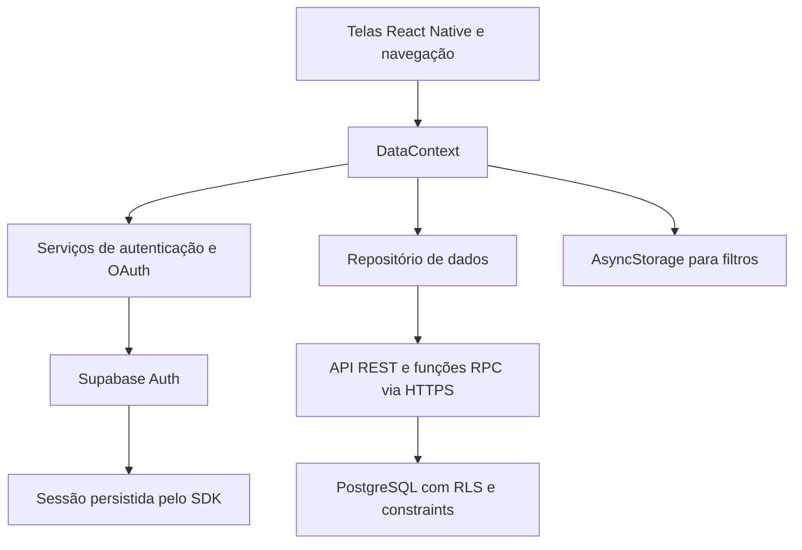
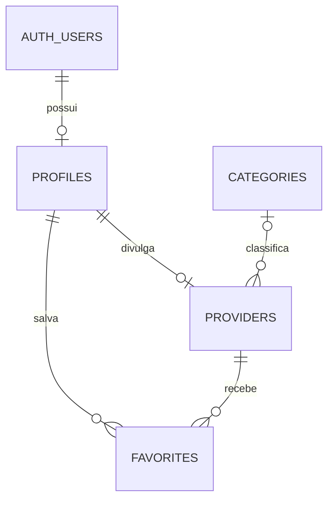

# Etapa 05 — Aplicação mobile integrada ao Supabase

## Objetivo e situação

O Vai uma mão ai conecta pessoas a prestadores locais. Nesta etapa, as telas de
cadastro, busca, detalhes, perfil e favoritos passaram a usar Supabase Auth e APIs
HTTPS do Supabase/PostgreSQL. O fluxo de negócio principal é criar, consultar, editar
e excluir um perfil profissional; autenticação e favoritos complementam a operação.

O código da integração, a migração SQL, os templates de e-mail e os testes locais
estão preparados. A situação abaixo registra o avanço até **25/10/2026**, distinguindo
verificação técnica, relato do responsável e validações ainda pendentes.

| Item | Situação e evidência |
| --- | --- |
| Projeto e conexão | Projeto criado; consulta real de configuração Auth retornou HTTP 200 |
| Migração SQL | Responsável executou e recebeu `Success. No rows returned` |
| Tabelas remotas | API reconheceu profiles, providers, categories e favorites; consultas anônimas negadas com 42501 |
| Confirmação de e-mail | Configuração real consultada com confirmação habilitada |
| SMTP | Responsável informou que configurou Gmail com senha de app no painel; segredo não incluído no projeto |
| Cadastro no aplicativo | Responsável relatou testes, incluindo repetição do mesmo e-mail; não há registro de auditoria que comprove contas duplicadas |
| Recuperação, CRUD e favoritos com duas contas | Implementados e cobertos parcialmente por testes locais; roteiro remoto completo ainda precisa ser registrado |
| Google | Implementado, mas provedor/configuração e development build ainda pendentes; botão desabilitado |

O visual verde anterior foi mantido. Os ajustes mais recentes no cadastro incluem
confirmação de senha e tratamento da resposta de cadastro repetido do Supabase Auth.

## Correspondência com o enunciado

O enunciado ETAPA 05.docx solicita a documentação em **docs/etapa-05.md**, não um
arquivo Word de resposta. Este é o arquivo de entrega correspondente. O backend é
de livre escolha, portanto a adoção do Supabase atende a essa condição.

| Requisito do enunciado | Onde está atendido ou descrito |
| --- | --- |
| Integração mobile/backend e divisão de responsabilidades | Arquitetura e responsabilidades; comunicação HTTP |
| Pelo menos um fluxo completo de negócio | Criar, consultar, editar e excluir um perfil; fluxo completo e roteiro de demonstração |
| Interface e navegação | Telas de autenticação, primeiro acesso, busca, detalhes, favoritos e perfil via React Navigation |
| Persistência local quando aplicável | Sessão e filtros no AsyncStorage; seção de persistência local |
| Entradas inválidas e feedback | Seção dedicada com validações, erros, espera e confirmações |
| Funcionalidades e decisões técnicas | Funcionalidades integradas, banco, arquitetura e troca de backend |
| Instruções de execução e teste | Seções de execução, roteiro manual e testes automatizados |
| README atualizado | README na raiz do repositório |
| Mesmo repositório, tag etapa-05 e link | Seção Repositório e entrega; conferir commit da tag antes da publicação final |

A cobertura documental não substitui a demonstração do fluxo com o backend remoto.
As pendências de validação estão registradas na situação da entrega. Capturas e vídeos
são evidências complementares opcionais no enunciado. Login com Google é uma extensão
do projeto, não uma exigência específica da atividade.

## Fluxo completo implementado

1. A pessoa informa nome completo, e-mail, senha e confirmação de senha na tela Cadastrar.
   As senhas devem ser idênticas; o aplicativo bloqueia o envio se forem diferentes ou
   se a confirmação estiver vazia. A confirmação não é enviada ao backend.
2. O Supabase Auth recebe a solicitação. Com Confirm email habilitado e SMTP configurado,
   envia o código pelo template de confirmação. A senha é entregue ao serviço por HTTPS.
3. A pessoa digita o código. O aplicativo chama verifyOtp; somente uma resposta válida
   cria a sessão. Código errado/expirado exibe erro e permite solicitar outro.
4. Após autenticar, o app carrega o perfil privado e apresenta “Você é prestador de serviços?”.
5. Não conclui o primeiro acesso e abre a busca. Sim cria/recupera um rascunho privado
   e abre o formulário. A mesma conta também pode buscar e favoritar prestadores.
6. A pessoa informa nome de divulgação, categoria, descrição, cidade/UF, WhatsApp,
   formas de atendimento e, opcionalmente, bairros/regiões.
7. Salvar rascunho mantém o perfil privado e permite retomar em Perfil. Publicar valida
   os campos no cliente e no banco, grava o registro e o disponibiliza na busca.
8. A busca consulta o backend por nome, cidade, UF e categoria, em páginas de 20 registros.
   Nome/cidade ignoram acentos e maiúsculas. Detalhes recupera o registro pelo ID.
9. O dono edita o perfil; outros usuários veem a atualização ao atualizar/reabrir a tela.
10. O dono confirma a exclusão. O banco remove o perfil e os favoritos relacionados
    em cascata. A conta continua disponível e pode divulgar serviços novamente.

Quem escolheu Não pode usar Perfil → Divulgar meus serviços posteriormente. O nome
da conta é separado do nome profissional. Um cadastro em rascunho nunca é listado
na busca. Voltar do formulário sem salvar descarta somente alterações não enviadas.

## Funcionalidades integradas

| Funcionalidade | Comportamento nesta etapa |
| --- | --- |
| E-mail e senha | Supabase Auth, confirmação de senha no cadastro, sessão persistente e logout local ao aparelho |
| Confirmação | Código real validado no servidor, template, expiração e reenvio |
| Recuperação de senha | Solicitar e-mail, validar código do tipo recovery e definir nova senha |
| Google | OAuth/PKCE, navegador do sistema, callback do app; exige configuração e development build |
| Primeiro acesso | Estado salvo em profiles; opção de divulgar serviços ou ir à busca |
| Prestador | Rascunho, publicação, consulta, edição e exclusão no banco |
| Busca | Consulta paginada, filtros e atualização por foco/puxar para atualizar |
| Favoritos | Por UUID autenticado, privados, sem duplicatas, sem copiar dados do prestador |
| Localização | expo-location com permissão, tratamento de falhas e campos editáveis |
| Contato | Deep link externo do WhatsApp; não há chat interno |
| Persistência local | Sessão do SDK e filtros por projeto/UUID no AsyncStorage |

Não são usadas as contas demonstrativas nem os profissionais fictícios na execução
atual. Os arquivos do repositório local antigo permanecem como histórico/testes e os
dados antigos não são apagados nem importados automaticamente por coincidência de e-mail.

## Decisão técnica: Firebase substituído por Supabase

A proposta inicial escolhia Firebase Authentication e Cloud Firestore. Na Etapa 5,
o backend adotado passou a ser Supabase Auth e PostgreSQL. A troca ocorreu na escolha
da implementação; não houve migração de uma base de produção do Firebase. A etapa
anterior usava persistência local demonstrativa, preservada como histórico.

O modelo contém relações explícitas entre conta, perfil profissional, categoria e
favoritos. PostgreSQL permite expressá-las por chaves estrangeiras e restrições:
um prestador por conta, uma categoria válida por perfil e um favorito por par
usuário/prestador. A exclusão em cascata evita favoritos apontando para perfis removidos.
Funções SQL executam alterações relacionadas em uma transação, e RLS aplica as
permissões de cada usuário junto ao banco.

Supabase oferece autenticação e APIs junto desse banco relacional, atendendo ao escopo
sem um servidor próprio. A familiaridade com a representação SQL e a possibilidade de
versionar o esquema na migração também orientaram a decisão. Firebase poderia atender
ao aplicativo com outra modelagem; a escolha não se baseia em uma superioridade geral
de um serviço sobre o outro. As referências a Firebase nas etapas anteriores registram
o planejamento original; README e esta etapa documentam a arquitetura vigente.

## Arquitetura e responsabilidades



O frontend apresenta dados, valida entradas para orientar o usuário e controla
carregamento/erros. O backend autentica e autoriza, aplica integridade e persiste os
dados compartilhados. O aplicativo usa apenas a chave pública publishable. Nenhuma
chave de administração ou segredo Google/SMTP deve ser incluído no bundle.

O timeout das requisições é de 20 segundos. A aplicação não repete automaticamente
uma escrita de resultado incerto: em perda de conexão depois de o servidor salvar,
a pessoa é orientada a atualizar os dados antes de tentar de novo. Escritas do app
são enfileiradas, com verificação da conta ativa; respostas de contas anteriores não
são aplicadas à conta atual. O SDK renova a sessão quando o aplicativo está ativo.

## Banco de dados



| Tabela | Campos e restrições principais |
| --- | --- |
| auth.users | Gerenciada pelo Supabase Auth; contas e identidades de autenticação |
| profiles | id referenciando auth.users, full_name, onboarding_step, datas; leitura/escrita privada |
| categories | id, name único, is_active; leitura por autenticados, gestão administrativa |
| providers | id, user_id único, display_name, category_id, description, city, state, whatsapp, service_modes, service_regions, status e datas |
| favorites | Chave composta user_id/provider_id, data de criação e referências com exclusão em cascata |

`onboarding_step` usa choose, provider_form ou complete. `status` usa draft ou published.
`service_modes` é uma lista validada de at_customer, own_location e online. As relações
com contas usam UUID, nunca e-mail como chave de propriedade.

RLS limita a alteração do prestador ao dono; permite leitura dos publicados por
usuários autenticados e dos rascunhos somente pelo dono. Perfil privado e favoritos
são acessíveis somente pelo proprietário. Categorias não podem ser alteradas pelo app.
O usuário não tem permissão para transferir o user_id de um perfil profissional.

O trigger de auth.users cria profiles com nome inicial e progresso choose. A função
begin_provider cria/recupera o rascunho e atualiza o primeiro acesso na mesma transação.
A função save_provider grava o formulário e conclui o primeiro acesso atomicamente.
Ambas executam como o chamador, mantendo RLS. O banco valida os campos mínimos para
publicação, limites de texto, UF e formatos aceitos. A categoria referenciada existe
por chave estrangeira; a função de publicação verifica se ela está ativa.

A migração está em `supabase/migrations/202610250001_etapa05.sql`. Foi preparada para
execução única e contém a carga inicial de categorias. Não contém dados pessoais reais.

## Comunicação HTTP conforme o material da disciplina

O SDK oficial encapsula fetch, requisições assíncronas e conversão JSON. Não existe
acesso direto ao banco com senha pelo aplicativo. O token da sessão é enviado em
Authorization; a chave pública identifica o projeto. O serviço decide o acesso via RLS.

| Operação | Requisição utilizada |
| --- | --- |
| Consultar perfil/categorias/favoritos/detalhes | GET em /rest/v1, filtros pela URL |
| Concluir primeiro acesso | PATCH em /rest/v1/profiles |
| Favoritar | POST em /rest/v1/favorites, corpo JSON |
| Desfavoritar/excluir perfil | DELETE com filtros pela URL |
| Iniciar/salvar cadastro | POST em /rest/v1/rpc/begin_provider ou save_provider; transação no servidor |
| Buscar com normalização/paginação | POST em /rest/v1/rpc/search_providers; função somente de leitura |
| Autenticação, código e recuperação | Endpoints /auth/v1 gerenciados pelo SDK |

A busca é um exemplo de RPC de leitura com POST: não se apresenta esse endpoint como
GET. A escolha permite normalizar acentos e limitar a paginação no banco. A exclusão
é DELETE; edições de formulário usam RPC para salvar também o progresso atomicamente.

Respostas 2xx permitem atualizar o estado confirmado. Erros 401/403, validações,
limites 429 e falhas 5xx recebem mensagens específicas quando o serviço fornece o
status/código. Nem todo 4xx significa erro de programação do frontend: pode indicar
permissão, sessão, limite ou uma entrada que o usuário precisa corrigir.

## Persistência local conforme o material da disciplina

React Context mantém estado volátil; AsyncStorage mantém sessão/preferências entre
execuções. Os filtros são serializados com JSON.stringify e recuperados com JSON.parse.
`preferences.js` oferece leitura, gravação e remoção e separa as chaves por projeto e
UUID. A chave antiga de demonstração é preservada e nunca promovida a autenticação.

O AsyncStorage não é o banco principal nem uma fila offline. Não oferece criptografia
própria; a sessão é persistida pelo SDK conforme a integração React Native do Supabase.
As senhas e códigos digitados não são gravados pelo aplicativo. Dados estruturados
compartilhados, como prestadores e favoritos, pertencem ao PostgreSQL remoto.

## Entradas inválidas e feedback

- Cadastro exige nome/sobrenome, e-mail válido, senha de pelo menos 8 caracteres e
  confirmação exatamente igual, sem remover espaços ou alterar a senha digitada.
- E-mail é normalizado com remoção de espaços externos e conversão para minúsculas.
- O Supabase pode ocultar a existência de uma conta no retorno de signUp. Quando retorna
  identidades vazias, o app não avança como se fosse um novo cadastro e orienta a entrar
  ou recuperar a senha. Erros explícitos de duplicidade também recebem mensagem própria.
  Repetir uma solicitação de cadastro não comprova duas contas criadas; a conferência é
  feita em Authentication → Users. Cadastro ainda não confirmado pode continuar pendente.
- A confirmação exige código numérico e validação real pelo Supabase. Não há código fixo.
- A recuperação valida o código como recovery e exige repetir a nova senha.
- Publicação exige categoria válida, nome, descrição de 10 a 1.000 caracteres,
  cidade, UF brasileira, WhatsApp 55 + DDD + número e forma de atendimento.
- Rascunhos permitem campos vazios; valores preenchidos ainda respeitam limites e formatos do banco.
- Botões mostram espera e evitam envios duplicados. Falhas preservam campos para correção.
- Há mensagens de sucesso ao salvar/publicar/excluir e confirmação antes de excluir.
- O coração e o anúncio de acessibilidade indicam a alteração de favorito.
- Busca, detalhes e favoritos oferecem atualização e repetição em caso de erro.
- Negar localização mantém a alternativa manual. Falha em abrir WhatsApp produz aviso.

## Execução e configuração

Em uma nova instalação:

1. Crie um projeto Supabase e execute uma vez a migração
   `supabase/migrations/202610250001_etapa05.sql` no SQL Editor. Não repita no projeto
   atual, onde ela já foi aplicada.
2. Em Authentication, mantenha o provedor Email e Confirm email habilitados e a senha
   mínima de 8 caracteres. Configure Custom SMTP antes de editar os templates.
3. Use `supabase/templates/confirmation.html` em Confirm signup e
   `supabase/templates/recovery.html` em Reset password. O campo `{{ .Token }}` envia
   o código digitado no aplicativo. Credenciais SMTP ficam somente no painel.
4. Crie `.env` a partir do exemplo e preencha `EXPO_PUBLIC_SUPABASE_URL` e
   `EXPO_PUBLIC_SUPABASE_PUBLISHABLE_KEY` com os dados públicos do projeto. Mantenha
   `EXPO_PUBLIC_GOOGLE_AUTH_ENABLED=false` enquanto Google não estiver configurado.
5. Instale as dependências, inicie o Expo e siga o roteiro de teste abaixo.

```powershell
npm ci
if (!(Test-Path .env)) { Copy-Item .env.example .env }
# Preencher .env com URL HTTPS e chave publishable
npx expo start --go --clear
```

Senha, OTP e CRUD podem ser testados no Expo Go SDK 58. Google usa uma development
build com scheme vaiumamaoai e callback vaiumamaoai://auth/callback. Templates de
confirmação e recuperação ficam em `supabase/templates`. Não há credenciais no Git.

Para habilitar Google posteriormente, configure um cliente OAuth Web no Google Cloud
com o callback informado pelo Supabase (`https://SEU-PROJETO.supabase.co/auth/v1/callback`).
Cadastre Client ID e Client Secret somente no provedor Google do painel Supabase,
autorize `vaiumamaoai://auth/callback` em Redirect URLs, habilite a variável Google
e gere uma development build. O segredo Google nunca pertence ao aplicativo.
Essa configuração é adicional ao fluxo obrigatório de e-mail/senha.

## Roteiro de teste e demonstração

1. Criar uma conta A com e-mail real e confirmar o código recebido.
2. Testar código errado, expirado e reenvio após o intervalo.
3. Responder Sim, salvar um rascunho incompleto, encerrar e reabrir o aplicativo.
4. Retomar o rascunho em Perfil; conferir que não aparece na busca.
5. Completar os campos e publicar. Encontrar o perfil na busca e conferir detalhes.
6. Em outra conta B/aparelho, encontrar e favoritar o perfil de A; reabrir e conferir.
7. A altera a descrição. B atualiza a tela e verifica o novo texto.
8. Tentar alterar/excluir o perfil de A com sessão B: a API deve negar/afetar zero linhas.
9. A exclui o perfil e confirma. B atualiza busca/favoritos: o perfil desaparece.
10. Conferir que A continua com conta válida, mesmo sem perfil profissional.
11. Testar uma conta nova escolhendo Não; posteriormente usar Divulgar meus serviços.
12. Alterar filtros, encerrar e reabrir. Conferir que persistem apenas para a mesma conta.
13. Sair, reabrir e confirmar a tela de login. Entrar por senha e testar recuperação.
14. Na development build, testar Google, cancelamento e retorno por deep link.
15. Desligar a conexão ao consultar/salvar: conferir mensagem e ausência de sucesso falso.
16. Negar localização, preencher manualmente e testar abertura do WhatsApp.
17. Deixar Confirmar senha vazio e depois informar uma senha diferente: o app deve
    mostrar o erro no campo e não enviar a solicitação. Repetir com senhas iguais.
18. Tentar cadastrar novamente um e-mail já confirmado: verificar o feedback e conferir
    Authentication → Users. A senha da conta existente não deve ser substituída por
    uma tentativa de novo cadastro; usar recuperação para alterá-la.

Screenshots ou vídeo devem mostrar registros reais e o mesmo ID antes/depois da edição.
Há relato de cadastro no aparelho, mas ainda não foram anexadas capturas ou vídeo que
documentem todo o roteiro. A entrega real de e-mail deve ser demonstrada no teste manual.

## Testes automatizados e resultados

```powershell
npm test
npx expo-doctor
npx expo export --platform android --platform ios --output-dir dist
```

- Testes de regressão do repositório local anterior e de normalização de localização.
- PostgreSQL via PGlite executando a migração, CRUD, rollback, constraints, RLS entre
  duas contas, rascunho privado, favoritos únicos e exclusão em cascata.
- SDK Supabase com HTTP controlado verificando métodos, corpo JSON, headers e erros.
- Autenticação verificando payloads de senha/OTP/recovery e propagação de erro do servidor.
- Regressão para resposta com identidades vazias e erro explícito de cadastro existente,
  preservando o caminho válido de criação de uma conta nova.
- Timeout/cancelamento de fetch e persistência/isolamento dos filtros locais.

A execução local mais recente registrou **31 testes aprovados**. A configuração base
passou em 20/20 verificações do Expo Doctor e gerou bundles Android/iOS. A tela de login
com confirmação de senha também foi compilada pelo Babel. O PGlite simula apenas o schema Auth para os testes SQL;
não executa GoTrue, PostgREST, SMTP ou Google. Os testes HTTP usam respostas controladas.
No ambiente Windows utilizado, TEMP/TMP foram apontados para `dist/.expo-temp` para
permitir geração do bytecode Hermes; o resultado foi salvo em `dist/etapa05`.

## Repositório e entrega

Repositório: https://github.com/doSantus/vai-uma-mao-ai

A entrega inclui este documento, README, código mobile, SQL, templates e testes no
mesmo repositório. A tag local etapa-05 identifica o snapshot inicial da implementação;
as alterações posteriores precisam ser commitadas e não atualizam essa tag automaticamente.
Antes de publicar a entrega final, conferir o commit referenciado pela tag e o conteúdo
da branch. Não incluir `.env`, credenciais SMTP, senha do banco ou chaves administrativas.
O envio ao GitHub não foi realizado pelo assistente nesta atualização.

Antes da apresentação final, concluir a configuração Google e registrar os resultados
reais do roteiro com duas contas, incluindo código de e-mail e recuperação de senha.

## Referências utilizadas

- ETAPA 05.docx, enunciado fornecido pelo usuário: integração mobile/backend, fluxo completo,
  validação, feedback e itens de entrega.
- Jáderson Cruz. Integração com Serviços Web: O Protocolo HTTP no Ecossistema Mobile.
  Material fornecido, páginas 4–20: request/response, métodos, headers, JSON, status e async/await.
- Jáderson Cruz. Persistência Local de Dados: AsyncStorage (RN) vs. SharedPreferences/Hive (Flutter).
  Material fornecido, páginas 2, 5, 7–9 e 17: volatilidade, serialização, CRUD e limites do AsyncStorage.
- https://supabase.com/docs/guides/auth/quickstarts/react-native
- https://supabase.com/docs/guides/auth/auth-email-templates
- https://supabase.com/docs/guides/auth/auth-smtp
- https://supabase.com/docs/guides/auth/native-mobile-deep-linking
- https://supabase.com/docs/guides/database/postgres/row-level-security
- https://docs.expo.dev/guides/authentication/
